# Pragmatic UI

> **The universal pragmatic WebUI design system.**
> One dependency-free stylesheet that turns any WebUI — admin panels, dashboards,
> monitoring consoles, AI chat frontends — into a coherent, accessible,
> dark-first product. Bare HTML already looks right. Everything else is opt-in.

```html
<link rel="stylesheet" href="pui.min.css">
<script type="module" src="pui.min.js"></script>  <!-- optional -->
```

---

## Gallery

One design system, two themes, one accent variable. The ops dashboard demo, dark and light — same markup, only tokens differ:

<p align="center">
  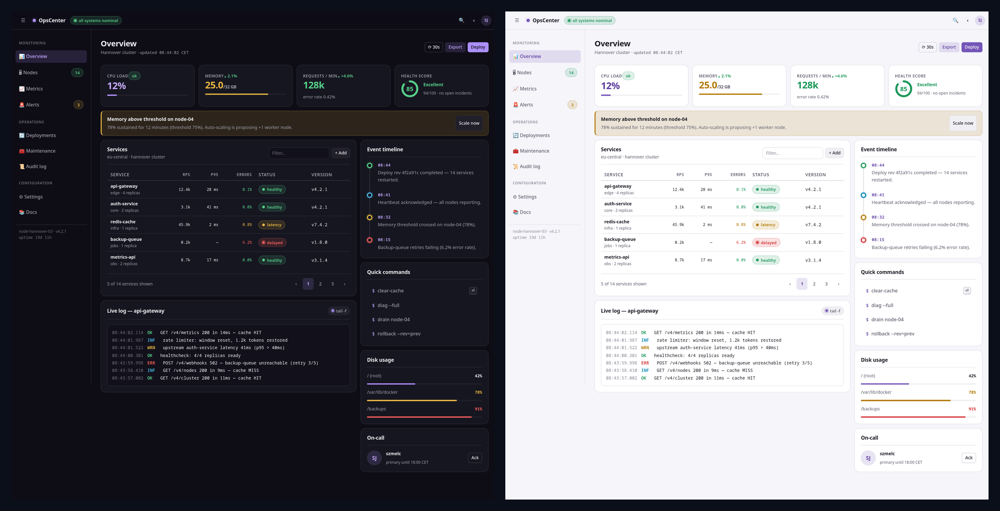
</p>

The entire system retints from a single OKLCH hue variable — surfaces, accents, focus rings, status colors, shadows, even the card borders:

<p align="center">
  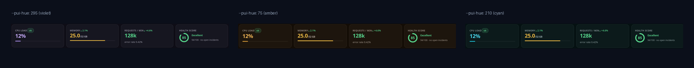
</p>

**Components** (all live and interactive in [`docs/index.html`](docs/index.html)):

<p align="center">
  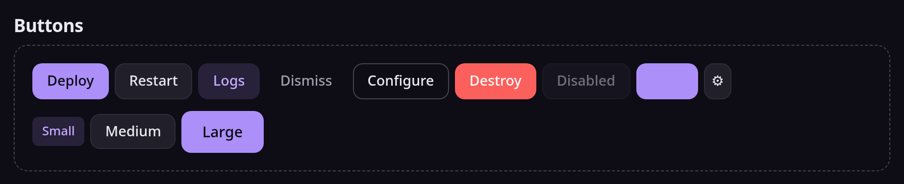&nbsp;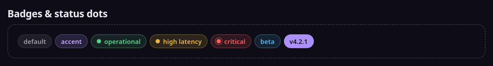
</p>
<p align="center">
  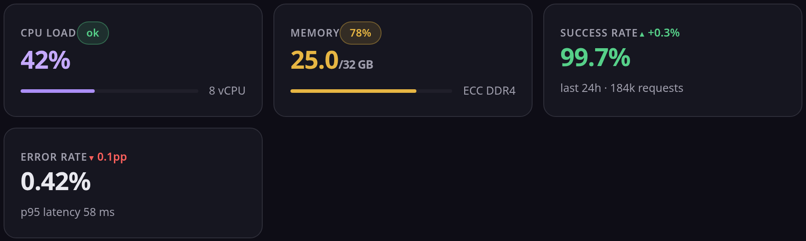&nbsp;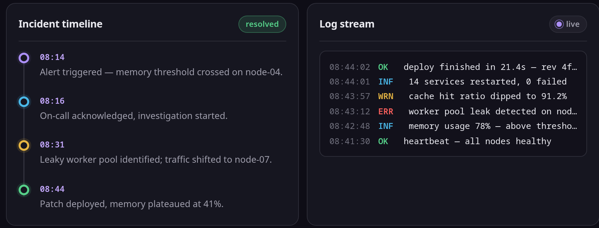
</p>
<p align="center">
  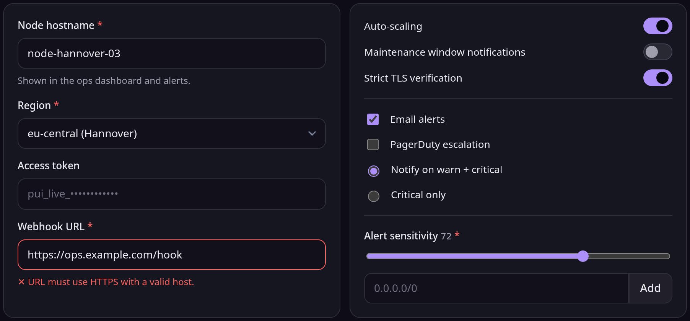&nbsp;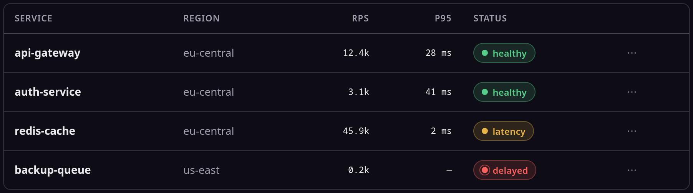
</p>
<p align="center">
  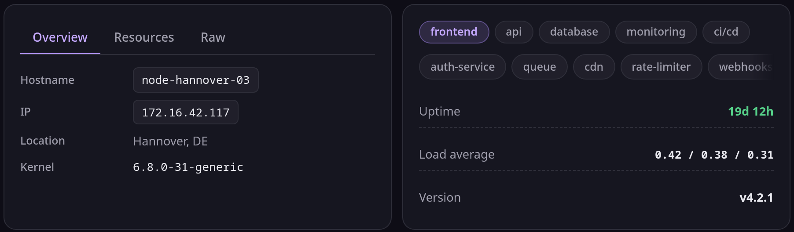&nbsp;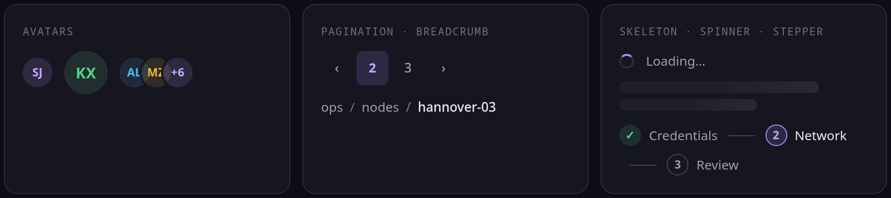
</p>

**Overlays** — native `<dialog>`, CSS-only dropdowns and tooltips, toasts, and the ⌘K command palette:

<p align="center">
  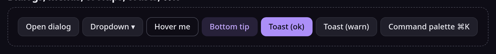
</p>
<p align="center">
  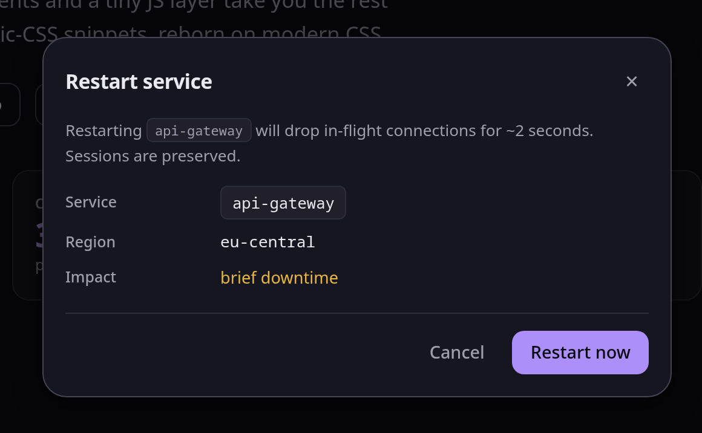&nbsp;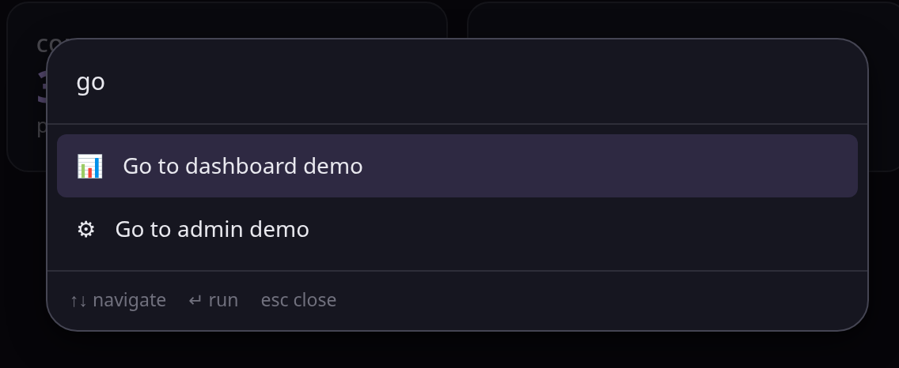&nbsp;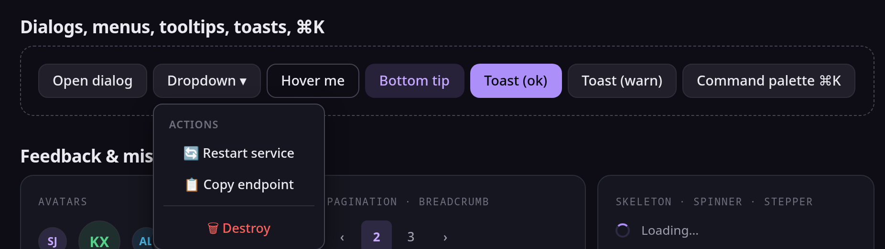
</p>
<p align="center">
  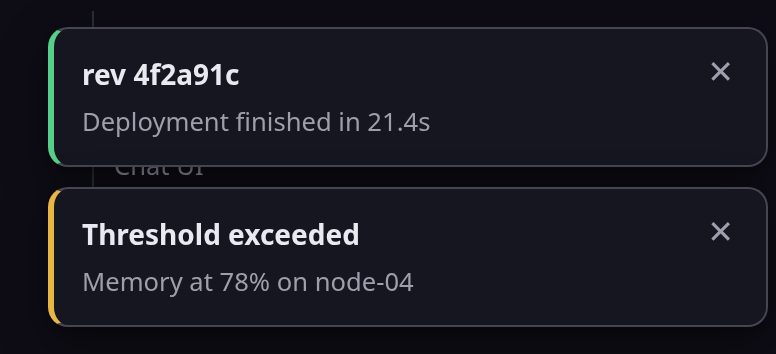&nbsp;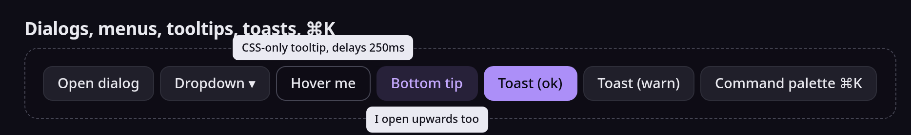
</p>

**Demos** — [dashboard](docs/demo-dashboard.html) · [admin](docs/demo-admin.html) · [chat](docs/demo-chat.html):

<p align="center">
  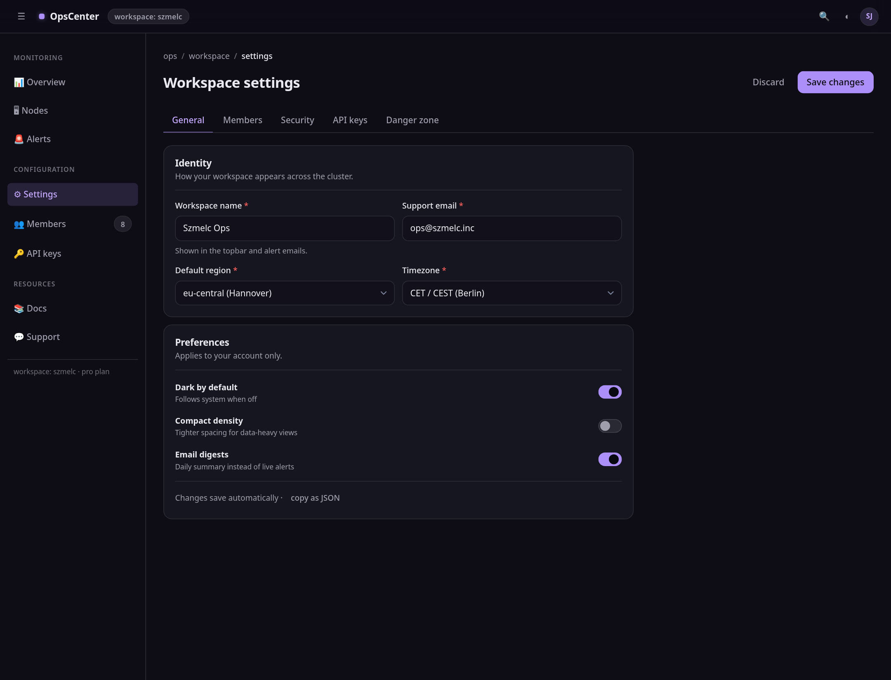&nbsp;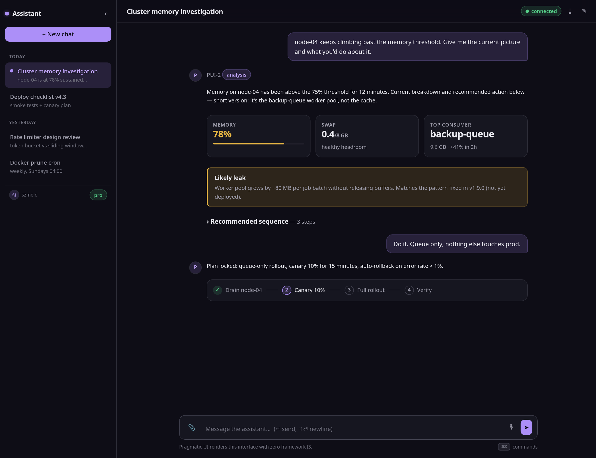
</p>
<p align="center">
  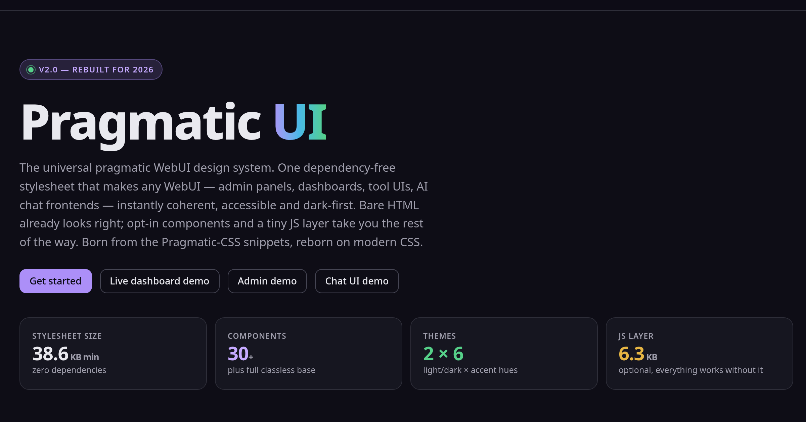&nbsp;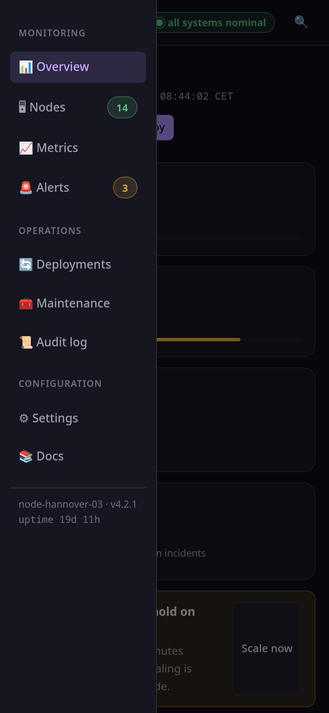
</p>

*(All screenshots are captured with a CDP-driven headless Chromium — pixel-exact element clips, no mockups.)*

---

## What this is

Pragmatic UI (short: **pui**) is the evolution of this repository — the old
`Pragmatic-CSS` collection of inline-styled grok.com snippets — rebuilt as a real
design system on modern CSS standards, while keeping the original's DNA:

| Kept from the original | Rebuilt for 2026 |
|---|---|
| Dark "ops-professional" aesthetic (slate surfaces, colored metric numbers, left-border alerts, timelines, status dots) | OKLCH token engine — the whole system derives from `--pui-hue`, soft variants computed at runtime with `color-mix()` |
| Zero-JS pragmatism (`<details>`, checkbox hacks, progressive disclosure) | Native behavior layer: `<dialog>`, popover API, `@starting-style` transitions — plus an optional 6 KB JS module for tabs/toasts/⌘K |
| AI-generated UI as the primary use case (SKILL.md prompts) | A proper [SKILL.md](SKILL.md) agent skill + a restricted-renderer mode (inline-styles-only) for chat surfaces |

- **Zero dependencies, zero build step, zero webfonts.** ~39 KB CSS min, ~6 KB JS min.
- **Cascade layers** (`tokens → base → components → utilities`) mean predictable
  precedence, easy overrides, and clean Tailwind interop (utilities always win).
- **Works without JS**: dropdowns are `<details>`, modals are `<dialog>`, tabs have a
  radio-based fallback, tooltips are CSS-only.

## Quick start

**Drop-in** — copy `dist/pui.min.css` (and optionally `dist/pui.min.js` or the IIFE
build) into your project and link it. Done: every bare element is styled.

**npm**

```sh
npm i pragmatic-ui
```

```js
import "pragmatic-ui/pui.css";
import "pragmatic-ui/pui.js"; // optional behavior layer
```

**Tailwind v4**

```css
@import "tailwindcss";
@import "pragmatic-ui/tailwind/pui-theme.css";
@import "pragmatic-ui/src/pui.css";
```

Now `bg-surface`, `text-muted`, `border-line`, `text-accent` resolve against live pui
tokens (theme switching and hue re-accenting keep working), and Tailwind utilities
always take precedence over pui component classes.

**Docs & live demos** — serve the repo (`npm run serve` → http://localhost:8123):

- [`docs/index.html`](docs/index.html) — full component gallery, theming playground, token reference
- [`docs/demo-dashboard.html`](docs/demo-dashboard.html) — ops monitoring dashboard (app shell, KPIs, tables, log stream, timeline, ⌘K palette)
- [`docs/demo-admin.html`](docs/demo-admin.html) — settings/admin panel (tabs, forms, data table, dialogs)
- [`docs/demo-chat.html`](docs/demo-chat.html) — AI chat interface built only from pui primitives

## Architecture

```
src/
  pui.css   ← the system: tokens · base · components · utilities (cascade layers)
  pui.js    ← optional behaviors: theme, tabs, dialogs, toasts, ⌘K, copy, sidebar
tailwind/
  pui-theme.css ← Tailwind v4 @theme inline bridge (+ dark: variant remap)
dist/         ← pui.css / pui.min.css / pui.min.js / pui.iife.js
docs/         ← docs site + three full application demos
legacy/       ← the original Pragmatic-CSS snippets, prompts and skill (preserved)
SKILL.md      ← agent skill for AI-driven UI generation
```

### Theming

```html
<html data-hue="violet">                <!-- accent presets: blue cyan violet green amber red -->
<html data-theme="light">               <!-- force light (default: follows prefers-color-scheme, dark-first look) -->
<html data-density="compact">           <!-- compact | cozy | comfort -->
```

Or override tokens directly — a custom theme is a few lines:

```css
:root {
  --pui-hue: 190;            /* OKLCH accent hue — retints the entire system */
  --pui-r-l: 8px;            /* sharper cards */
  --pui-font-sans: "Inter", system-ui, sans-serif;
}
```

Key tokens: `--pui-bg/surface/raised/hover/field` · `--pui-line/-strong` ·
`--pui-text/muted/faint` · `--pui-accent` (+`-strong/-hover/-soft/-softer/-on`) ·
`--pui-ok/warn/danger/info` (+`-soft`) · `--pui-r-s/m/l/xl/pill` · `--pui-dur/-ease` ·
`--pui-shadow-1/2` · `--pui-sidebar-w/-topbar-h`.

### Behavior layer (`pui.js`)

Declarative hooks: `[data-theme-toggle]` · `[data-open="dialog-id"]` ·
`[data-close]` · `[data-menu="popover-id"]` · `[data-copy]` · `[data-cmdk]` ·
`[data-sidebar-toggle]` · keyboard-driven `role="tablist"`.
Programmatic API: `pui.toast(msg, { title, type })`, `pui.theme()`,
`pui.openDialog(el)`, `pui.hue`, `pui.copyText(t)`.

## Component inventory

Buttons (6 variants × 3 sizes, busy state) · badges & status dots · alerts · metric
cards & deltas · cards · forms (fields, hints, switches, input groups, validation) ·
tables (wrap, zebra, sticky, select rows) · tabs (JS + zero-JS) · dialogs ·
dropdown menus & popovers · CSS-only tooltips · toasts · command palette (⌘K) ·
timelines · log streams · progress bars · spinners & skeletons · steppers ·
pagination · breadcrumbs · avatars · tags & filter chips · key/value grids ·
stat lines · app shell (topbar + collapsible sidebar + mobile drawer).

## Browser support

Evergreen browsers. Requires: cascade layers, `color-mix()`, OKLCH,
`:focus-visible`, `<dialog>`. Progressive extras: popover API, anchor positioning
for popover menus, `@starting-style`, `:has()` (sidebar collapse, selected rows),
`mask-image` (scroll fades). No IE/legacy Safari.

## For AI agents

This repo started as prompts that taught assistants to render rich UI inside chat
responses. [SKILL.md](SKILL.md) is the modern successor: a skill that makes any
code-generating agent emit correct, accessible Pragmatic UI — including a
**restricted renderer mode** (inline-styles-only HTML for surfaces like grok.com
that strip classes/JS).

## Legacy

The original snippet collection is preserved unchanged in [`legacy/`](legacy/)
(and on the `legacy-main` / `personal` branches). Its component ideas became the
`.metric`, `.timeline`, `.alert`, `.log`, `.kv`, `.tag` and footer status-bar
primitives of the system.

## License

[MIT](LICENSE) © Szmelc.INC
